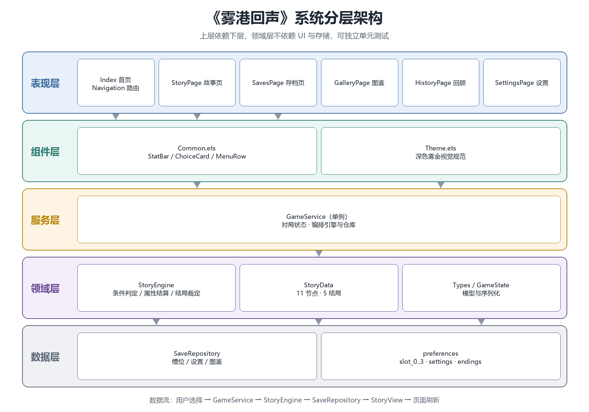
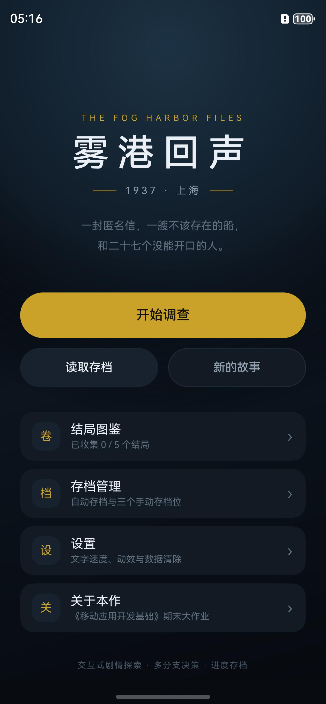
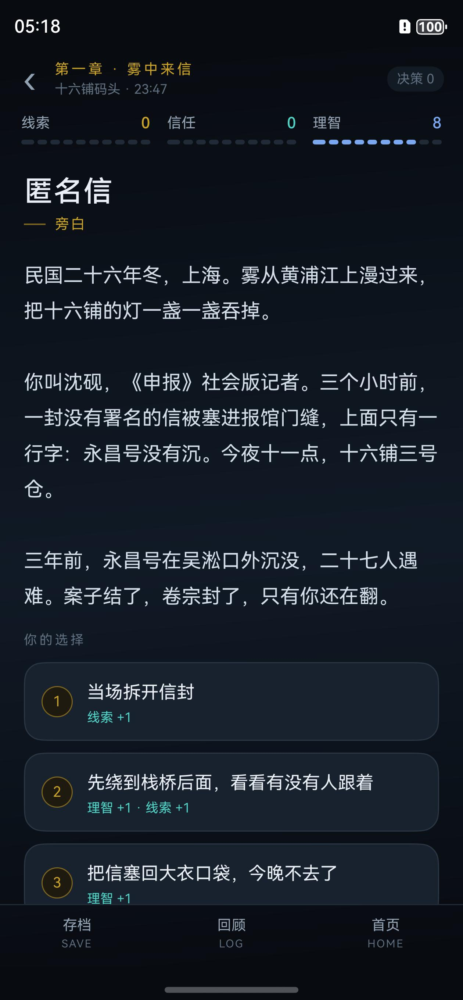
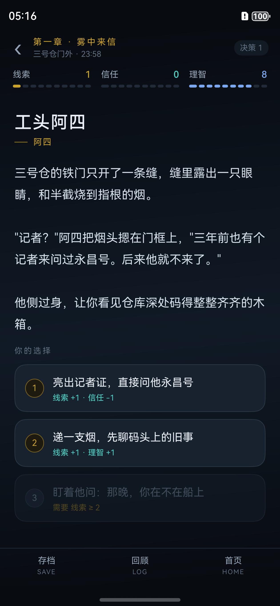
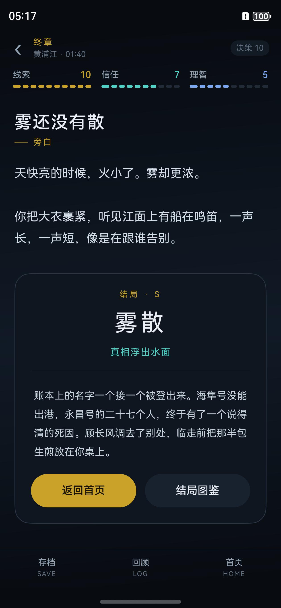
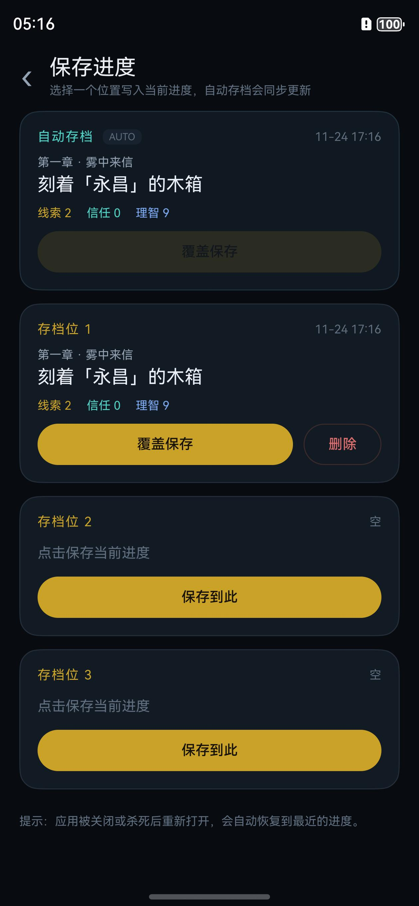
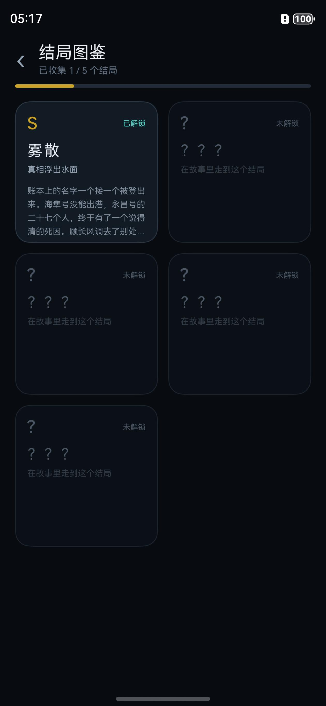
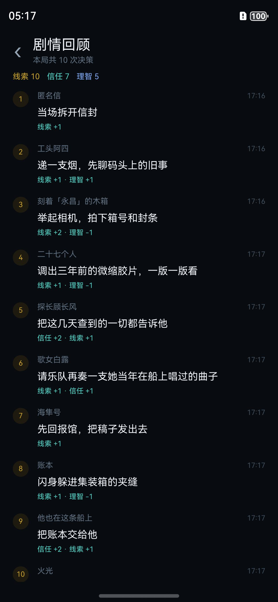

# 雾港回声 · FogHarbor

> 交互式剧情探索与多分支决策应用 · HarmonyOS / ArkTS / ArkUI
> 《移动应用开发基础》期末大作业（主题一）

[仓库](https://github.com/goodjinkela/fogharbor) · [需求说明书](docs/软件需求说明书.docx) · [报告模板](docs/移动应用开发基础-学号-姓名-期末大作业报告.docx) · [开发指南](docs/开发与提交指南.md)

---

## 一、项目简介

1937 年的上海，雾夜。你是《申报》记者沈砚，一封匿名信把你引向三年前沉没的「永昌号」。

《雾港回声》是一款**以数据驱动的交互式剧情应用**：剧情节点、选项、触发条件、属性变化全部由数据结构描述，由 `StoryEngine` 真实执行条件判断与结局裁定，而不是把分支写死在界面里。玩家的每一次选择都会改变「线索 / 信任 / 理智」三项属性，并决定最终走向 5 个不同结局。

应用支持**自动存档 + 3 个手动存档位**，关闭进程后重新打开可以从最近的决策点继续；结局图鉴跨周目保留，鼓励重复探索。

---

## 二、功能说明

| 模块 | 功能 |
| --- | --- |
| 剧情探索 | 11 个剧情节点、3 章 + 终章，逐字打字机呈现，可轻触跳过 |
| 多分支决策 | 每个节点 2–3 个选项；8 个条件选项按「线索 / 信任 / 理智」阈值动态解锁，未满足时置灰并提示原因 |
| 属性系统 | 线索、信任、理智三维属性，取值 0–10，属性变化即时反馈并记录 |
| 结局裁定 | 按优先级判定 5 个结局：雾散(S)、余烬(A)、共谋(B)、离岸(C)、失踪者(C) |
| 存档 | 自动存档实时写入；3 个手动存档位，支持覆盖、删除；读取后从该决策点继续 |
| 结局图鉴 | 记录已解锁结局，跨周目保留 |
| 剧情回顾 | 本局所有决策的时间线与属性变化 |
| 设置 | 打字速度（8–60ms/字）、动效开关、清除全部数据 |
| 视觉 | 统一深色雾金主题、渐变背景、卡片按压反馈、选项淡入动效 |

---

## 三、系统架构



五层结构，依赖自上而下：表现层（6 个页面）→ 组件层 → 服务层（GameService）→ 领域层（StoryEngine / 模型 / 剧情数据）→ 数据层（preferences）。

一次选择的链路：页面 → `GameService.choose()` → `StoryEngine` 校验并结算 → 写自动存档 → 生成 `StoryView` → 页面用 `@State` 刷新。页面不直接改状态，只消费只读视图。

---

## 四、技术栈

- **语言**：ArkTS（API 17）
- **UI**：ArkUI 声明式开发，`Navigation` + `NavPathStack` + `NavDestination`
- **状态管理**：`@State` / `@Prop` / `@StorageProp` + `@Watch`，单向数据流
- **持久化**：`@kit.ArkData` 的 `preferences`，JSON 序列化 + `flush()`
- **测试**：`@ohos/hypium` 单元测试（正常 / 边界 / 异常）
- **工程模型**：Stage 模型，单 HAP 模块 `entry`

---

## 五、开发与运行环境

| 项 | 版本 |
| --- | --- |
| DevEco Studio | 5.0.13（DS-233.14475.28.36.5013240） |
| HarmonyOS SDK | 5.0.5（API 17） |
| 模拟器 | Huawei_Phone，HarmonyOS 5.0.5(17)，x86_64 |
| 构建工具 | hvigor 5.17.6 |
| 目标设备 | phone / tablet / 2in1 |

---

## 六、目录结构

```
FogHarbor/
├── AppScope/                          # 应用级配置与图标
├── entry/src/main/ets/
│   ├── entryability/EntryAbility.ets  # 入口：深色主题、后台兜底存档
│   ├── pages/
│   │   ├── Index.ets                  # 首页 + Navigation 路由表
│   │   ├── StoryPage.ets              # 故事页（打字机、选项、结局）
│   │   ├── SavesPage.ets              # 存档 / 读档
│   │   ├── GalleryPage.ets            # 结局图鉴
│   │   ├── HistoryPage.ets            # 剧情回顾
│   │   └── SettingsPage.ets           # 设置
│   ├── component/Common.ets           # StatBar / ChoiceCard / MenuRow
│   ├── common/Theme.ets               # 视觉规范
│   ├── model/
│   │   ├── Types.ets                  # 领域模型与视图模型
│   │   ├── StoryData.ets              # 11 个节点 + 5 个结局
│   │   └── GameState.ets              # 对局状态与 JSON 序列化
│   ├── domain/StoryEngine.ets         # 条件判断、属性结算、结局裁定
│   ├── data/SaveRepository.ets        # preferences 读写
│   └── service/GameService.ets        # 应用级单例，串联引擎与仓库
├── entry/src/ohosTest/ets/test/       # Hypium 测试
├── docs/
│   ├── 软件需求说明书.docx
│   ├── 移动应用开发基础-学号-姓名-期末大作业报告.docx
│   ├── 开发与提交指南.md
│   └── images/                        # 架构图、导航图
├── tools/                             # 文档与图生成脚本
└── README.md
```

---

## 七、运行方式

**方式 A：命令行安装（无需华为账号）** —— 本机模拟器实测可行：

```powershell
# 1. 启动模拟器（DevEco 的 Device Manager 里点启动，或直接命令行）
& 'D:\HUAWEI\DevEco Studio\tools\emulator\Emulator.exe' -hvd Huawei_Phone -path D:/HUAWEISimulator -imageRoot D:/HUAWEISimulator/sdk

# 2. 构建 + 安装 + 启动
$env:JAVA_HOME='D:\HUAWEI\DevEco Studio\jbr'
$env:NODE_HOME='D:\HUAWEI\DevEco Studio\tools\node'
$env:PATH="$env:JAVA_HOME\bin;$env:NODE_HOME;$env:PATH"
$env:DEVECO_SDK_HOME='D:\HUAWEI\DevEco Studio\sdk'
hvigorw --mode module -p product=default -p module=entry@default assembleHap

hdc install entry\build\default\outputs\default\entry-default-unsigned.hap
hdc shell aa start -a EntryAbility -b com.goodjinkela.fogharbor
```

**方式 B：DevEco Studio 运行**：

1. `File > Open` 选择工程根目录，等待 Sync。
2. `Tools > Device Manager > Local Emulator` 启动 `Huawei_Phone`。
3. 选择模块 `entry`，点击 ▶ Run（如提示签名，可勾选自动签名；也可直接用方式 A）。
4. 配置签名：`File > Project Structure > Project > Signing Configs` → **Automatically generate signature**。

> 已验证：`assembleHap` 构建通过，未签名 HAP 可在本机 API 17 模拟器上直接安装运行（2026-11-24 实测）。

---

## 八、单元测试

`entry/src/ohosTest/ets/test/StoryEngine.test.ets`，9 条用例：

| 类型 | 用例 |
| --- | --- |
| 正常 | 选择后节点跳转、属性增加、日志写入；视图包含 3 项属性与 3 个选项；终局按属性判定结局 |
| 边界 | 属性恰好等于阈值时解锁；属性上下限夹取；四种比较运算符 |
| 异常 | 不存在的选项；未满足条件的选项；空 / 损坏的存档 JSON |

运行：DevEco 中右键 `StoryEngine.test.ets` → `Run`。

---

## 九、页面截图

均在本地模拟器 Huawei_Phone（HarmonyOS 5.0.5，1260×2720）实机运行截取。

| 首页 | 故事页 | 条件选项 |
| --- | --- | --- |
|  |  |  |

| 结局（S 级） | 存档 | 结局图鉴 |
| --- | --- | --- |
|  |  |  |

| 剧情回顾 |
| --- |
|  |

---

## 十、运行录屏

【待补充：录屏链接，建议 3–5 分钟，覆盖「新建 → 选择 → 存档 → 杀进程 → 恢复 → 结局」】

---

## 十一、开发说明

- 业务逻辑与 UI 解耦：`StoryEngine` 不依赖任何 UI 与持久化 API，可独立单元测试。
- 新增剧情只需在 `StoryData.ets` 追加节点，页面与引擎无需改动。
- 存档写入统一走 `SaveRepository.putString`，内部强制 `flush()`，避免杀进程丢档。
- 文档由 `tools/` 下脚本生成，修改内容后重新运行即可。

---

## 十二、许可证

本项目为课程作业，仅用于学习交流。
